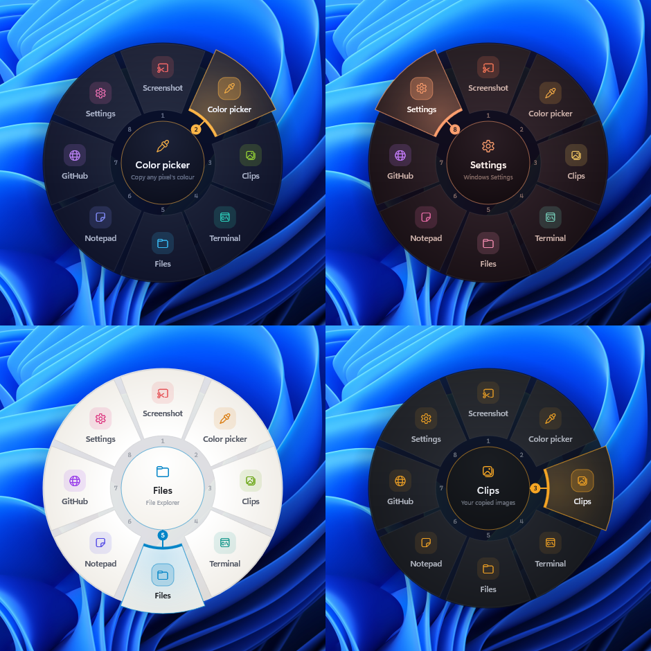
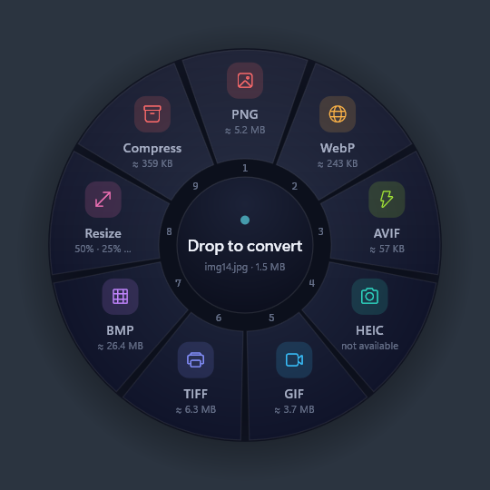

# Spoke

A radial command wheel for Windows. Press a shortcut, and a wheel of your apps, sites, folders, snippets and tools opens around the pointer. Point, click, done.

Native and tiny: C# / .NET 10 Native AOT, Direct2D + DirectComposition overlay, under 30 ms to open, under 40 MB idle. Free and open source ([MIT](LICENSE)).



**[Download Spoke for Windows](https://github.com/zainkhalid91/Spoke/releases/latest)** (64-bit Windows 10 or 11): unzip anywhere, run `Spoke.exe`, press **Ctrl+Alt+Z**. Nothing to install. The build isn't code-signed yet, so SmartScreen may ask you to confirm (*More info → Run anyway*).

**Status:** M1 done (config + real actions, below). M0 spike done (the wheel opens in 9–14 ms, focus never stolen; see [docs/SPIKE_REPORT.md](docs/SPIKE_REPORT.md)). M1a adds built-in tools and a new look:
- **Screenshot** (slice 1): drag a region, click a window, or Space for the whole screen. Copied, saved to Pictures\Screenshots, and added to Clips.
- **Color picker** (slice 2): magnifier loupe, arrow keys to nudge, keys 1–n copy a format. Uses your PowerToys Color Picker formats and colour history when present (format code from PowerToys, MIT; see [THIRD_PARTY_NOTICES.md](THIRD_PARTY_NOTICES.md)).
- **Clips** (slice 3): a wheel of your last 40 copied images, stored encrypted (DPAPI) in `%LOCALAPPDATA%\Spoke\clips`. Click to paste, Shift+click to copy, Del to remove, mouse wheel or Tab for more pages. Respects apps that mark clipboard data private.
- **Themes:** Aurora, Ember, Paper (light), Graphite and Onyx (near-black with vivid icons), from the tray menu.

Open the wheel with **Ctrl+Alt+Z**. Choose a slice on the ring or press 1–8; a click outside the wheel closes it.

**M1** makes the wheel yours: every slice comes from `%APPDATA%\Spoke\settings.json` (tray → *Edit settings*). Save the file and the wheel updates at once; if the file has a mistake, Spoke shows where and keeps the last good wheel. 2–12 slices. *Start with Windows* is in the tray menu.

**M1b** adds looks and utilities: *Match Windows* theme, Windows accent or custom slice colours, sizes S–XL (tray menu or `"theme": "Auto"`, `"accent": "windows" | "#3A86FF"`, `"size": "L"`), and four sub-wheels: **Files** (convert, resize, compress, strip metadata, PDF, Office ⇄ PDF on the Explorer selection), **Text tools**, **Generate** and **System**.

**M2** adds **Spoke Settings** (tray → *Settings…* or double-click the tray icon): edit the wheel, its shortcut (it tells you if another app holds it and suggests free ones), theme, colours, size and start-up. Changes apply in milliseconds.

**M3** adds **many wheels**: give each its own shortcut (Settings → Wheels), and press **Tab** / Shift+Tab or click a pill under the wheel to switch in place. **Group** slices hold up to 12 items that fan out around the slice, or with *Run every item* switched on (`"runAll": true`, `"delay": 500`) run them in order. Wheels export to and import from `.spoke` files (Settings → Wheels → ⋯, or `Start-Process -Wait Spoke.exe "--export Dev dev.spoke"` / `--import dev.spoke`); paths under your user folders become `%ENV%` forms. Icons keep the theme's colours; a Windows or custom accent only colours the highlight.



**Drop mode** converts files by dragging them. Drag images from File Explorer, keep holding the mouse button, press the wheel shortcut, and the wheel opens under the pointer as a format wheel: PNG, JPEG, WebP, AVIF, HEIC, GIF, TIFF, BMP, Resize ▸ and Compress. Each slice shows the **estimated size** before you drop. A worker process encodes full-resolution tiles sampled from across the picture and scales the result up; across test photos and screenshots the average error is 5%. Drop on a slice to convert beside the original (never overwriting); hover Resize for a moment, or drop on it, to pick a size. Several files convert as a batch. Other files (PDFs, Office documents) get the Files actions instead. WebP and AVIF use `ffmpeg` on PATH. HEIC needs Microsoft's HEIF and HEVC extensions; without them the slice says so. Esc closes the wheel and the drag carries on. `Spoke.exe --estimate-check report.txt image…` compares estimates with real conversions, and `--render out.png --drop image` draws the format wheel.
<br clear="right" />

**More options as an outer ring:** Files, Text tools, Generate and System open their options as a band that fans out around the slice, so the wheel stays in view (hub shows the path, e.g. *Files ▸ Convert*; Esc or the hub goes back, the slice again folds it, arrows/digits/Enter work too). Prefer the old way? Settings → Appearance → *More options*, or `"subMenus": "wheel"`. `Spoke.exe --render out.png [--theme Onyx] [--ring 3]` draws the wheel to a PNG without showing anything.

```jsonc
{
  "hotkey": "Ctrl+Alt+Z",
  "theme": "Aurora",                  // Aurora, Ember, Paper, Graphite, Onyx
  "wheels": [ { "name": "Spoke", "slices": [
    { "type": "tool", "tool": "screenshot" },                       // or colorPicker, clips
    { "type": "app", "target": "code.exe", "args": "D:\\Projects" }, // exe, path, .lnk or shell:AppsFolder\<AppID>
    { "type": "url", "target": "github.com", "browser": "firefox.exe" },
    { "type": "folder", "target": "%USERPROFILE%\\Downloads" },     // "open": "terminal" or "copyPath"
    { "type": "search", "engine": "youtube" },                     // google, duckduckgo, bing, wikipedia, github, or a URL with {query}
    { "type": "text", "label": "Sign-off", "text": "Thanks!\nSent {date}" }
  ] } ]
}
```

Text tokens: `{date}`, `{time}`, `{iso}`, `{unix}`, `{uuid}`, `{clipboard}`, `{date:dd MMM yyyy}`; write `{{` for a literal brace. Optional on any slice: `label`, `icon` (a name like `terminal`, `globe`, `mail` or a Segoe Fluent code point like `E943`).

Plan:
- [docs/SPEC.md](docs/SPEC.md): product spec, features by phase, done criteria
- [docs/ARCHITECTURE.md](docs/ARCHITECTURE.md): stack, processes, performance budgets
- [docs/UI_FLOW.md](docs/UI_FLOW.md): flows (Mermaid); rendered in `docs/wireframes/png/flows-*.png`
- [docs/wireframes/](docs/wireframes/): low-fidelity wireframes (HTML/SVG), rendered PNGs in `png/`
- [docs/BUILD_PLAN.md](docs/BUILD_PLAN.md): milestones, estimates, risks

Re-render wireframes: `node docs/wireframes/make-flows.js && bash docs/wireframes/render.sh`

## Build

Needs the .NET 10 SDK and the MSVC C++ build tools (VS 2019 or 2022 Build Tools) for Native AOT. If `vswhere.exe` isn't found, add `C:\Program Files (x86)\Microsoft Visual Studio\Installer` to `PATH`.

```powershell
dotnet test tests/Spoke.Core.Tests
dotnet publish src/Spoke.Daemon -c Release -r win-x64 -o publish/m2
dotnet publish src/Spoke.Settings -c Release -o publish/m2   # SpokeSettings.exe must sit next to Spoke.exe
publish/m2/Spoke.exe --bench 100 --label my-run   # latency/focus report in %LOCALAPPDATA%\Spoke
```

## License

Spoke is free and open source under the [MIT licence](LICENSE). Third-party code and its licences are listed in [THIRD_PARTY_NOTICES.md](THIRD_PARTY_NOTICES.md). Issues and pull requests are welcome.
