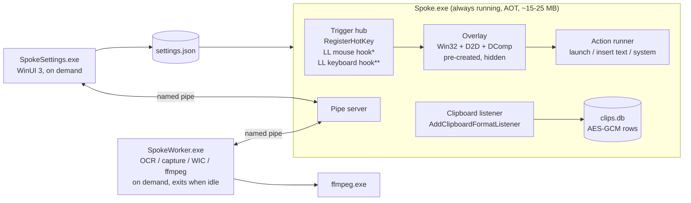

# Spoke: architecture

**Goal:** a wheel on screen in under 30 ms, a daemon idling under 40 MB and at 0% CPU, and no slowdown while heavy apps (local LLMs, IDEs, builds) are running.

## 1. Decisions at a glance

| Area | Decision | Why |
|---|---|---|
| Language/runtime | **C# on .NET 10 (LTS) with Native AOT** | Machine-code exe, no JIT warm-up, starts in ~50 ms, idles at ~10–20 MB. .NET 10 rather than 9 because 9 is short-term support and leaves support in May 2026, while 10 is supported to Nov 2028. |
| Win32/COM interop | **Microsoft.Windows.CsWin32** (source-generated P/Invoke and COM, `allowMarshaling: false`) | Fully trimmable and AOT-safe, maintained by Microsoft, and covers Win32, D2D1, DComp, DXGI, D3D11, Core Audio and Shell. **Fallback:** Vortice.Windows for D2D if CsWin32's COM ergonomics slow us down. The spike decides. |
| Overlay rendering | **Raw Win32 window + Direct2D drawn into a DirectComposition swap chain** | GPU-composited per-pixel alpha with no `UpdateLayeredWindow` CPU copies. DWM composes it like any other window. |
| Settings UI | **WinUI 3 (Windows App SDK), separate process `SpokeSettings.exe`**, Native AOT | Modern Fluent look and real drag-and-drop lists. It costs 60–120 MB, but **only while it's open**. The daemon never loads XAML. |
| Heavy work | **On-demand worker process `SpokeWorker.exe`** for OCR, screenshots, image/video conversion | Keeps WinRT, WIC, OCR models and ffmpeg piping out of the daemon. Starts in ~60 ms (AOT) and exits after 30 s idle. |
| IPC | **Named pipe** `\\.\pipe\Spoke-{user SID}` with length-prefixed JSON, source-generated serializers | Small, local-only, and the pipe ACL is limited to the current user. |
| Config | `%APPDATA%\Spoke\settings.json` (System.Text.Json source-gen), watched with `ReadDirectoryChangesW` | Hand-editable and diff-able. Settings writes the file and pings the daemon over the pipe, and the daemon swaps in the new config atomically. |
| Clipboard store | **SQLite** (Microsoft.Data.Sqlite + e_sqlite3, AOT-ok) in `%LOCALAPPDATA%\Spoke\clips.db`. Each row is encrypted with **AES-GCM**, and the 256-bit key is wrapped with **DPAPI (CurrentUser)** | Per-row AES is fast. DPAPI ties the key to the Windows account, so copying the DB to another machine or user gives you garbage. |
| Images | **WIC**, plus bundled libwebp for WebP if the system has no WIC WebP encoder. HEIC is only offered if the HEIF Image Extensions codec is present. | Built into Windows, fast, no extra licensing. |
| Video | **Bundled ffmpeg (LGPL build, shared libs, no GPL/non-free codecs)**, run as a child process by the worker | Proven, and keeps licensing simple. Encoders are H.264 via Media Foundation (`h264_mf`) and VP9/AV1 via libvpx/libaom (LGPL-compatible). No x264 (GPL). |
| Packaging | **MSIX** (Store + winget), code-signed. Also a signed portable zip. | Clean install/uninstall, auto-update. |

## 2. Processes


\* The low-level mouse hook is installed **only** while hot corners, shake or mouse-button triggers are on.
\*\* The low-level keyboard hook is installed **only while a wheel is open**, or while a hold-mode hotkey is held.

## 3. The overlay (the part that has to be perfect)

**Window:** one per process, created at start-up and kept hidden.
- Styles: `WS_POPUP`, `WS_EX_NOACTIVATE | WS_EX_TOOLWINDOW | WS_EX_TOPMOST | WS_EX_NOREDIRECTIONBITMAP`. No taskbar button, not in Alt+Tab, never activated.
- `WM_MOUSEACTIVATE` returns `MA_NOACTIVATE`, so clicking the wheel doesn't take focus. It's shown with `SetWindowPos(... SWP_NOACTIVATE | SWP_SHOWWINDOW)` and never with `ShowWindow(SW_SHOW)`.
- While open, it **covers the monitor under the pointer**. Every click lands on us: a click on the ring (or within 9 px of its edge) picks that slice, and a click anywhere else closes the wheel without running anything. To stay out of Windows' "fullscreen app" heuristics (Focus Assist, taskbar auto-hide), the window is sized to the monitor's work area and is not marked fullscreen.
- Per-monitor DPI v2 (`SetProcessDpiAwarenessContext(PER_MONITOR_AWARE_V2)`). On open: `MonitorFromPoint` → `GetDpiForMonitor` → move/resize → set the D2D DPI. There's no stretching. Everything is drawn at native resolution.

**Rendering:**
- A D3D11 device (BGRA, `D3D11_CREATE_DEVICE_BGRA_SUPPORT`), a DXGI swap chain from `CreateSwapChainForComposition` (premultiplied alpha, `FLIP_SEQUENTIAL`, 2 buffers), a D2D1 device context, and `IDCompositionTarget` → visual → swap chain. All of it is created **at start-up**.
- Only a square the size of the wheel (plus padding for petals) has pixels. The rest of the monitor-sized window is transparent but still hit-testable. An optional dim layer is a separate DComp visual with an opacity animation that DWM runs.
- Static layers (slice shapes, icons, labels) are drawn once per wheel/DPI into a cached `ID2D1Bitmap1`. A frame is just: blit the cache, draw the hover lift, the needle and the hub text. That's well under 1 ms of GPU work.
- **Open animation:** a DComp scale+opacity animation (70–120 ms, eased). It runs in DWM, so it doesn't depend on our thread being scheduled.
- **GPU contention (local LLMs):** if a model has the GPU at 100%, our D3D work can queue behind it. Mitigations, measured in the spike: (1) the first frame comes from the pre-rendered cache, so there's only one tiny draw; (2) a **renderer setting `Auto | GPU | CPU (WARP)`**: a 480×480 D2D frame on WARP costs ~1–2 ms of CPU. In `Auto` mode, Spoke switches to WARP if a GPU frame ever takes more than 12 ms.

**Input while open (we don't have focus, by design):**
- Mouse: the overlay window gets `WM_MOUSEMOVE` / `WM_LBUTTONUP` directly.
- Keyboard: a `WH_KEYBOARD_LL` hook is installed **when the wheel opens and removed when it closes**. It swallows only 1–9, the arrow keys, Enter, Esc, Tab and Shift+Tab, and passes everything else through. The hook callback only posts a message and returns, in under 50 µs.

**Hotkey → first frame path (target p95 < 30 ms, aim < 16 ms):**
`WM_HOTKEY` → read cursor → pick monitor → `SetWindowPos` (no activate) → `Present` the cached frame → `IDCompositionDevice::Commit`. No allocation, no file I/O, no icon decoding. Icons are pre-decoded into GPU bitmaps when the config loads.

## 4. Staying fast under heavy load

| Threat | Mitigation |
|---|---|
| CPU saturated by AI/builds | The daemon's UI thread runs at `THREAD_PRIORITY_HIGHEST`, and the process is opted out of EcoQoS (`SetProcessInformation(ProcessPowerThrottling)` with throttling off), so Windows never parks it on efficiency cores or throttles its timers. |
| LL-hook timeout (Windows drops slow hooks after `LowLevelHooksTimeout`) | Hook callbacks do arithmetic only: no locks, no allocation, no I/O. Work is posted to the UI thread. Hooks are installed only when a feature needs them. |
| Memory pressure paging us out | The daemon is small (no XAML, no WinRT, no JIT). The render cache is a few MB of GPU memory. Optional: after start-up, `SetProcessWorkingSetSizeEx` sets a modest *soft* minimum so the hot path stays resident. |
| GC pauses | `<ServerGarbageCollector>false</ServerGarbageCollector>` and `<ConcurrentGarbageCollection>false</ConcurrentGarbageCollection>`, plus a zero-allocation hot path (structs, pooled buffers, no LINQ), so there's nothing to collect while the wheel is open. |
| Disk contention | Config and icons are loaded into memory at start-up and on change. Clipboard DB writes go to a background thread with WAL mode. |
| GPU contention | See §3. Cached first frame, plus the WARP fallback. |

## 5. Focus and text insertion (risk #1)

Because the overlay is never activated, the user's app **keeps keyboard focus the whole time**, so `SendInput` goes straight to it.
- **Insert text:** for text up to ~200 characters, `SendInput` with `KEYEVENTF_UNICODE` (layout-independent). For longer text or rich content: save the clipboard (all formats) → set ours → `SendInput` Ctrl+V → restore the saved clipboard after ~300 ms. The restore is skipped if the user copied something else in the meantime.
- **Search box and similar prompts** are the one place that needs focus: a small input window is activated with `SetForegroundWindow`. That's allowed because we just received the hotkey input. When it closes, focus goes back to the previous foreground window (`GetForegroundWindow` saved at open).
- **Elevated (admin) target windows:** UIPI blocks `SendInput` and LL hooks from a normal-integrity process into an elevated one. Spoke detects this (it compares the target process's token elevation) and falls back to *"Copied. Press Ctrl+V"* with a toast. Option for power users: **run Spoke elevated at logon** via Task Scheduler (`Run with highest privileges`). `uiAccess` isn't viable for MSIX.

## 6. Triggers

| Trigger | Mechanism |
|---|---|
| Hotkey (tap) | `RegisterHotKey` per wheel. A failure means it's taken, and the UI shows it immediately. |
| Hotkey (hold, release to choose) | `RegisterHotKey` opens the wheel, then a temporary LL keyboard hook watches for key-up. |
| Mouse buttons | `WH_MOUSE_LL`: middle-hold (more than 200 ms, so a normal middle-click still passes through) or X1/X2. |
| Hot corners | `WH_MOUSE_LL` move events, compared against cached monitor rects (refreshed on `WM_DISPLAYCHANGE`). A dwell timer starts only on entry. Optionally skipped when the foreground window is fullscreen (`SHQueryUserNotificationState`). |
| Shake | A ring buffer of the last 12 move samples in the hook. Counts sign changes of dx over a window of 600 ms and more than 40 px. Pure arithmetic. |
| File drag | The overlay calls `RegisterDragDrop` (OLE `IDropTarget`). If the hotkey fires while an OLE drag is in progress, the wheel opens in drop mode. A drag into a hot corner does the same. Explorer's *Convert with Spoke…* menu uses an MSIX `IExplorerCommand`. |

## 7. Clipboard

- `AddClipboardFormatListener` on a message-only window. `WM_CLIPBOARDUPDATE` → check skip rules → read → encrypt → queue the write.
- **Skip rules:** the formats `ExcludeClipboardContentFromMonitorProcessing`, `Clipboard Viewer Ignore`, or `CanIncludeInClipboardHistory` = 0 (KeePass, 1Password, Bitwarden and Windows itself use these). Also the source app is on the user's exclude list (`GetClipboardOwner` → PID → exe), the "pause history" toggle is on, or Spoke itself is the writer (a marker format).
- **Retention:** a cleanup runs at start-up and once per hour while idle (a single waitable timer, coalesced, not a polling loop).

## 8. Data formats

`settings.json` (shape; full schema in `src/Spoke.Core/Config`):
```json
{
  "version": 1,
  "wheels": [{
    "id": "w_dev", "name": "Dev", "accent": "#F5A524", "slices": 8, "size": "M",
    "triggers": [{ "type": "hotkey", "keys": "Ctrl+Alt+Space", "mode": "tap" }],
    "items": [
      { "label": "VS Code", "action": { "type": "app", "path": "%LOCALAPPDATA%\\Programs\\Microsoft VS Code\\Code.exe" } },
      { "label": "Repos", "action": { "type": "folder", "path": "D:\\Projects", "variant": "terminal" } },
      { "label": "Search", "children": [
        { "label": "Google", "action": { "type": "search", "engine": "google" } },
        { "label": "MDN", "action": { "type": "search", "template": "https://developer.mozilla.org/search?q={query}" } }
      ]}
    ]
  }],
  "clipboard": { "enabled": true, "retentionDays": 30, "maxItems": 2000, "excludeApps": ["KeePassXC.exe"] },
  "appearance": { "renderer": "auto", "animation": "subtle", "blurBehind": false },
  "sounds": { "theme": "off", "volume": 0.6 }
}
```
`.spoke` export = `{ "spoke": 1, "wheel": { … } }`, with absolute paths rewritten to `%ENV%` forms and Store apps referenced by AUMID.

## 9. Repo layout (planned)

```
Spoke/
  src/
    Spoke.Daemon/      Spoke.exe: tray, triggers, overlay, actions, clipboard (AOT)
    Spoke.Core/        config model, JSON source-gen, IPC contracts, action model (no UI)
    Spoke.Render/      D2D/DComp wheel renderer + layout math (angles, hit-testing)
    Spoke.Settings/    SpokeSettings.exe: WinUI 3
    Spoke.Worker/      SpokeWorker.exe: OCR, capture, WIC, ffmpeg
  tests/
    Spoke.Core.Tests/  layout math, config round-trip, token expansion, skip rules
  tools/bench/         hotkey→frame latency harness, idle memory/CPU sampler
  packaging/           MSIX manifest, assets, signing scripts
  docs/                spec, architecture, flows, wireframes, build plan
```

## 10. Performance budgets (checked in CI on every milestone)

| Metric | Budget | How it's measured |
|---|---|---|
| Hotkey → first frame on screen | **p95 < 30 ms** (aim p50 < 12 ms) | `tools/bench`: injects the hotkey with `SendInput`, timestamps with QPC, detects the frame via `DwmGetCompositionTimingInfo` / a present callback. 200 runs. Repeated with a GPU-heavy local LLM running. |
| Wheel switch / hover redraw | < 4 ms CPU, at the display refresh rate | ETW / internal QPC timers |
| Idle RAM (daemon) | **< 40 MB working set**, < 25 MB private | `GetProcessMemoryInfo` after 10 min idle, clipboard on, 5 wheels |
| Idle CPU | **≈ 0%** (0 wake-ups/s with hooks off, < 0.1% while the pointer moves with the mouse hook on) | `QueryProcessCycleTime` over 10 min, plus Windows Performance Recorder |
| Cold start (logon → tray ready) | < 300 ms | QPC from `Main` to tray icon added |
| Settings window open | < 800 ms | (it's a separate process, so this doesn't affect the daemon) |

## 11. Build toolchain notes
- **.NET 10 SDK** (to be installed) and **C++ build tools for the Native AOT linker**. This machine has VS 2019 Build Tools. If ILCompiler needs a newer MSVC linker, add *VS 2022 Build Tools → Desktop development with C++* (asks the user first).
- Builds in this environment may need `TEMP`/`TMP` set to `D:\tmp`.
