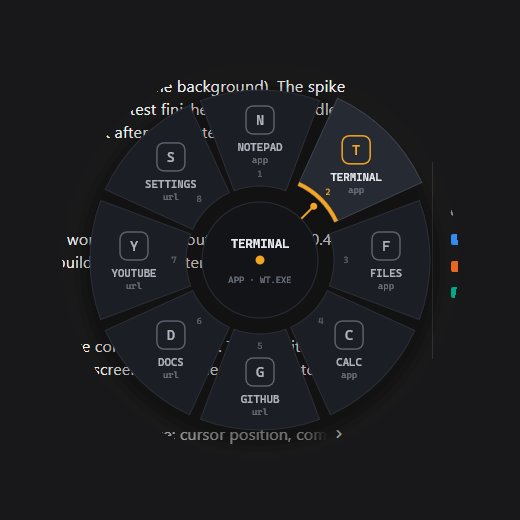

# M0 spike report

**Date:** 2026-11-25 · **Build:** `publish/spike2/Spoke.exe` (Native AOT, 1.9 MB, single file) · **Machine:** Windows 11 (26300), Intel UHD 630 driving the display + NVIDIA GTX 1660 Ti Max-Q, 12 logical cores, 144 Hz panel (6.94 ms refresh)

**Verdict: GO.** Raw Win32 + Direct2D + DirectComposition on .NET 10 Native AOT, with CsWin32 for all interop, meets every M0 budget, including with a local LLM generating and with every CPU core at 100%. CsWin32 is confirmed as the interop layer, and Vortice isn't needed.

## What was built
- `Spoke.exe`: tray icon (menu: Open wheel / Pause / Quit), single instance, global hotkey with automatic fallback when the shortcut is taken.
- The overlay is a `WS_EX_NOACTIVATE | WS_EX_TOOLWINDOW | WS_EX_TOPMOST | WS_EX_NOREDIRECTIONBITMAP` window plus a D3D11 → D2D → DXGI composition swap chain → DComp visual, all created at start-up.
  - An 8-slice wheel opens at the pointer, clamped on-screen, at the monitor's DPI.
  - The hovered slice lifts outward, its inner edge lights up, the needle (the "spoke") points at it, and the hub shows the label.
- Choosing: point and click, click anywhere past the ring (it picks by angle), keys 1–8 and numpad, arrows plus Enter, Esc, right-click or a hub click to close, and the hotkey again to toggle.
- Keyboard while open uses a `WH_KEYBOARD_LL` hook that exists **only while the wheel is open** and swallows only the wheel's keys.
- Foreground changes while open (Alt+Tab, clicking on another monitor) close the wheel, using `SetWinEventHook` (out-of-context).
- Actions: apps (`notepad`, `wt`, `explorer`, `calc`) and URLs/URIs (`github.com`, `learn.microsoft.com`, `youtube.com`, `ms-settings:`) via `ShellExecuteEx`.
- Stays responsive under load: the UI thread runs at `THREAD_PRIORITY_HIGHEST`, the process is opted out of EcoQoS, and the GC is workstation non-concurrent.
- Memory: the working set is handed back to Windows 60 s after the wheel closes (a one-shot timer, not polling).
- `Spoke.Core`: wheel geometry/hit-testing and hotkey parsing, covered by **30 unit tests (all passing)**.
- `Spoke.exe --bench N [--trim] [--warp]`: an automated harness. It drives the **real input path** (`SendInput` → `RegisterHotKey` → `WM_HOTKEY` → draw/present/commit → DWM) against a separate focus-target process, presses arrows and Esc while the wheel is open, then types text and reads it back from the target.

## Results

Each run is 100 opens. "Total" = from `SendInput` of the hotkey to DWM having applied our commit. The pixels reach the screen at the next vblank after that, which is at most +6.9 ms on this 144 Hz panel.

| Scenario | Total p50 | Total p95 | Total max | Our code (hotkey → shown), mean | Focus kept |
|---|---|---|---|---|---|
| Idle machine, GPU renderer | **9.4 ms** | **12.7 ms** | 16.2 ms | 3.4 ms | 100/100 ✓ |
| Local LLM generating (qwen2.5:7b, NVIDIA 43% avg, CPU 57%) | 9.7 ms | 13.5 ms | 16.2 ms | 3.8 ms | 100/100 ✓ |
| **All 12 cores at 100% CPU** | 11.1 ms | 14.0 ms | 14.7 ms | 4.6 ms | 100/100 ✓ |
| Paged out (working set emptied before **every** open) | 11.0 ms | 19.8 ms | 27.4 ms | 4.9 ms | 100/100 ✓ |
| CPU fallback renderer (WARP), idle | 13.7 ms | 20.4 ms | 27.2 ms | 4.9 ms | 100/100 ✓ |
| *(LLM model loading from disk: not a fair load test, kept for the record)* | 12.1 ms | 21.5 ms | 35.1 ms | 4.4 ms | 100/100 ✓ |

**Budget: p95 < 30 ms. Met in every scenario.** The only sample over 30 ms (35.1) was in the OS input stage while the 5 GB model was streaming off disk.

Breakdown of our own open path (idle, means): monitor/DPI/hit-test 0.06 ms · draw + present 1.2 ms · DComp commit 0.02 ms · `SetWindowPos` show 2.1 ms. Hover and arrow-key redraws take about 1 ms each (keypress → frame presented: mean 0.9 ms, max 5 ms).

**Focus:** across 600+ opens, the foreground window and focused control **never changed**. In every run, text typed after all the opens landed in the target app.

### Memory and CPU at idle
| Measure | Result | Budget |
|---|---|---|
| CPU over 180 s idle (tray + hotkey, no wheel) | **0 ms** (0.000% of one core) | < 0.1% |
| Working set / private, no trim | 40.4 MB / 15.1 MB | < 40 MB |
| Working set / private, 60 s after close (trim) | **0.2 MB / 15.3 MB** | < 40 MB |
| Cost of the trim | One 15.6 ms CPU tick, once per close | none |
| Threads / handles at rest | 3 / about 260 | none |

Without the trim, the 40 MB working set is mostly shared GPU-driver pages. With the trim, Spoke drops to almost nothing in Task Manager, and the next open costs the "paged out" row above.



## Things the spike found
1. **Ctrl+Alt+Space is already taken on this PC** by another app (probably another app's quick-entry shortcut). Risk #2 showed up on day one. Spoke now tries a candidate list and says which shortcut it ended up with; here that's **Ctrl+Alt+Z**. Onboarding (M11) must let the user record their own, and `--hotkey "…"` works now.
2. **Moving/resizing the overlay on every open cost about 2 ms.** It now only moves when the monitor changes.
3. **This laptop renders the wheel on the Intel iGPU** (the display adapter), while Ollama uses the NVIDIA card, so the LLM test here doesn't cover *same-GPU* contention. That needs a single-GPU desktop, or forcing the wheel onto the NVIDIA adapter, in M1. The WARP fallback numbers above show the safety net works if that case is bad.
4. **The working set at rest is mostly shared GPU-driver DLLs** (about 26 MB of 43 MB); private memory is about 17 MB. Trimming 60 s after close brings the idle working set down to a few MB. The first open after a long idle then costs the "paged out" numbers (p95 20 ms), which is still within budget.
5. **Foreground permission for the bench target:** a lone Alt tap opens a window's menu mode. The bench uses Alt + F24 instead. That's only relevant to test tooling and future "send keys" actions.
6. **Start-up:** Main → tray + hotkey ready takes 144 ms warm and 450 ms on the very first cold run (GPU driver load). The budget was 300 ms; cold start is over it, but it happens once per logon. M1 can create the D3D device after the tray icon appears so the tray shows in under 100 ms.

## Not covered yet (and where it lands)
- Same-GPU contention (see 3), mixed-DPI testing on a second monitor (only one display is attached right now), and admin-window behaviour → M1.
- Launching actions on a separate STA thread, so a slow `ShellExecuteEx` can never block the UI thread → M1.
- Open/close animation (DComp scale + opacity), app icons, the wheel row → M1–M3.

## How to run
```powershell
D:\Projects\Spoke\publish\spike2\Spoke.exe                    # tray + wheel (Ctrl+Alt+Z on this PC)
D:\Projects\Spoke\publish\spike2\Spoke.exe --hotkey "Ctrl+Alt+Q"
D:\Projects\Spoke\publish\spike2\Spoke.exe --bench 100 [--trim] [--warp] --label name   # writes %LOCALAPPDATA%\Spoke\bench-*.md
```
Raw bench reports: [docs/spike/](spike/).
