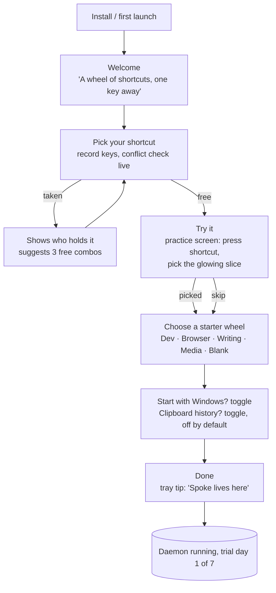
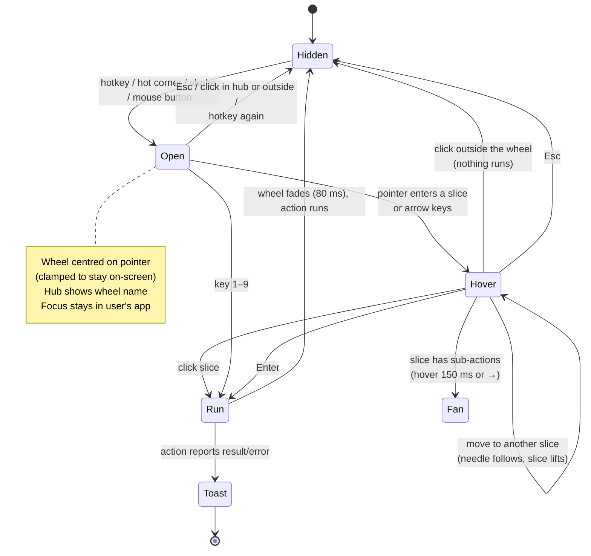
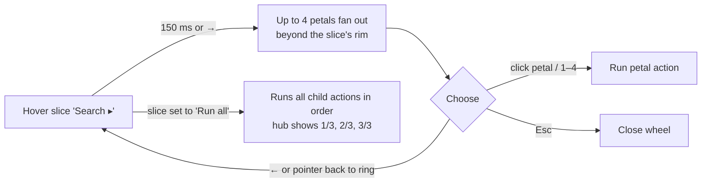
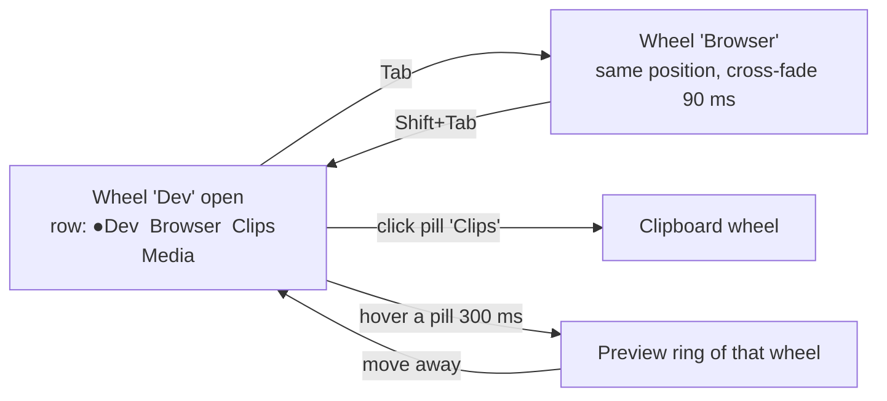
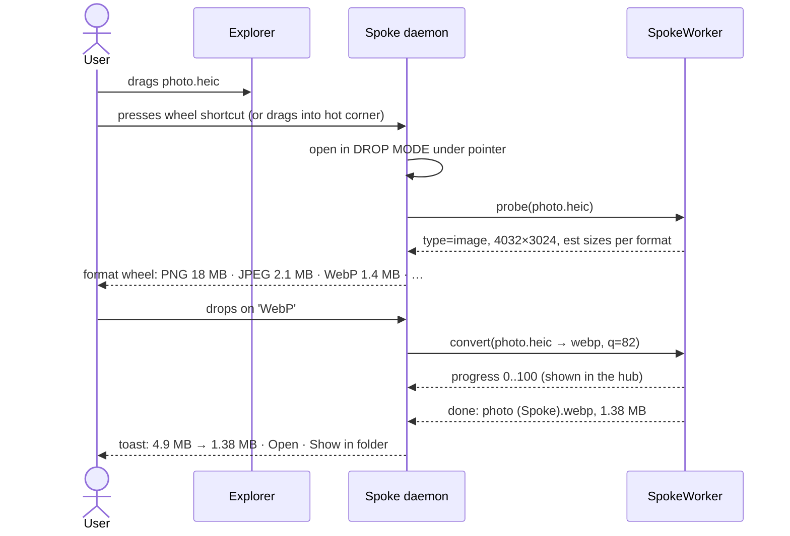
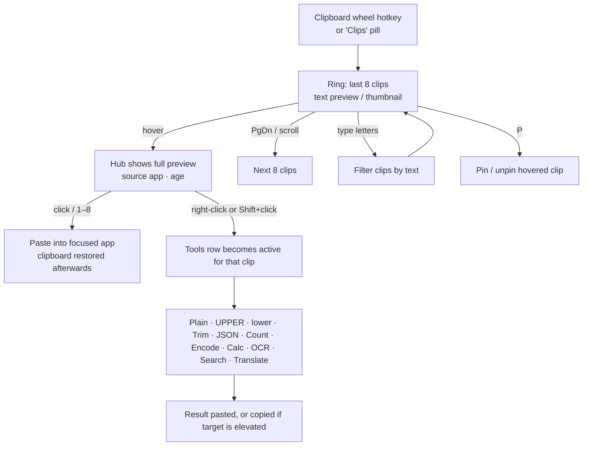
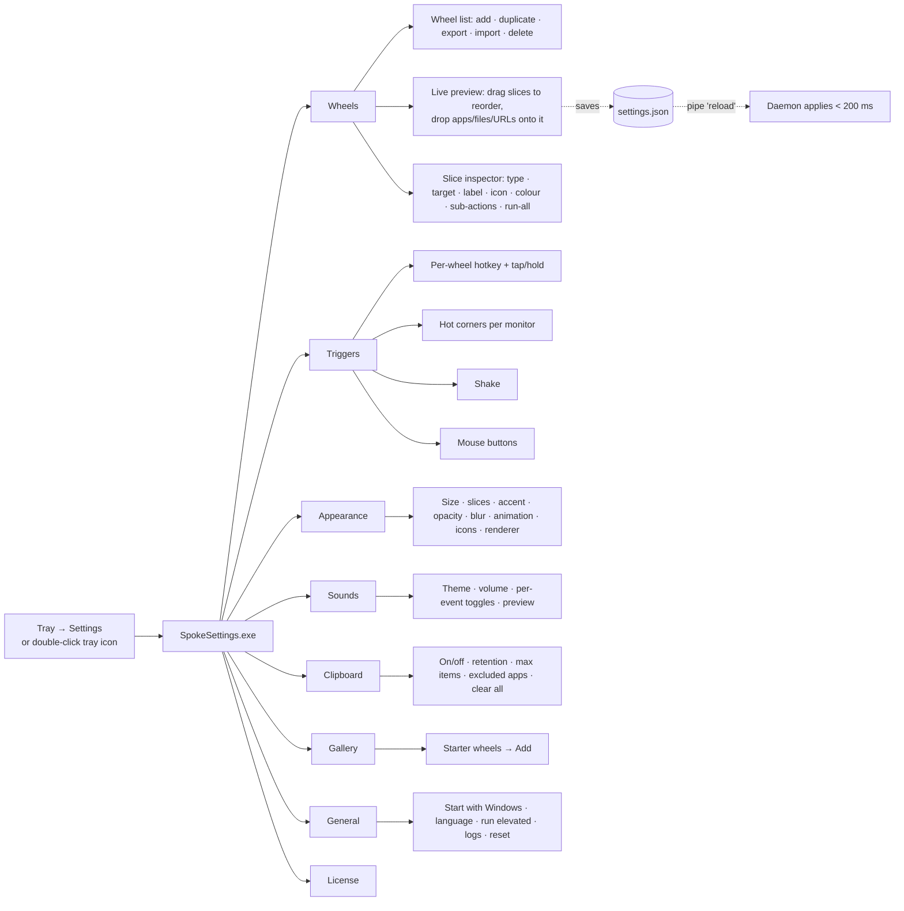
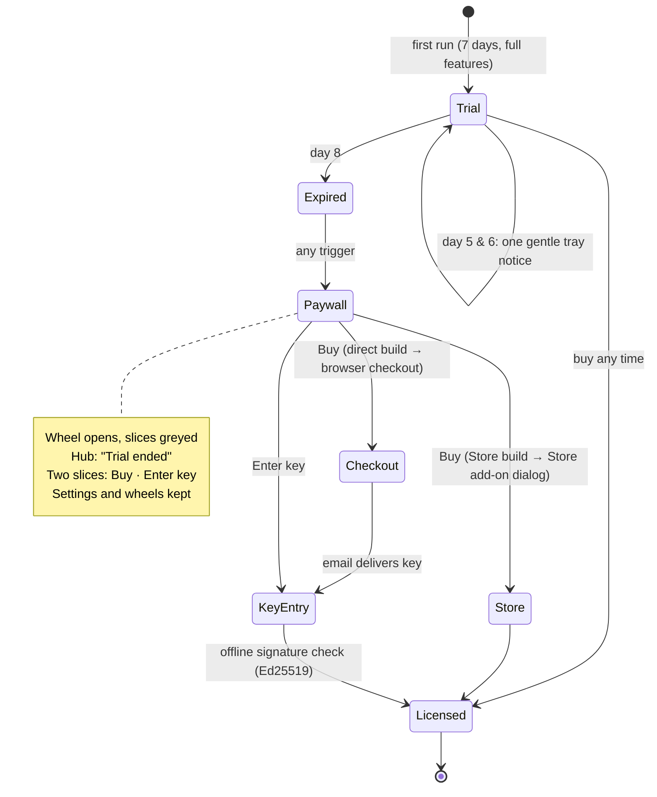

# Spoke: UI flows

Rendered versions of these diagrams are in `docs/wireframes/png/flows-*.png`.

## 1. First run and onboarding

## 2. Open the wheel and choose a slice

**Hold mode:** keep the hotkey held, point, and release. Releasing over a slice runs it. Releasing in the hub cancels.

## 3. Sub-actions (fan-out)

## 4. Switching wheels with the wheel row

## 5. File drop and conversion

Video files get a different format wheel: MP4 · WebM · MOV · MKV · GIF · Mute · Audio ▸ (MP3/AAC/WAV/Replace audio).

## 6. Clipboard history wheel

## 7. Settings app

## 8. Trial and purchase

